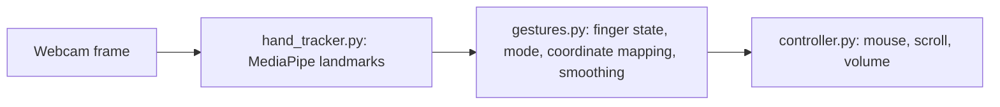

# aimouse: Hand-Gesture Mouse Control

[](https://github.com/poojabhather99/aimouse/actions/workflows/ci.yml)


Control your cursor, clicks, scrolling and system volume with hand gestures from a webcam. MediaPipe detects 21 hand landmarks per frame, a small gesture layer turns them into actions, and PyAutoGUI performs them.

## Gestures

| Gesture | Action |
|---|---|
| Index finger up | Move the cursor (mirrored, smoothed) |
| Index and middle fingers up, tips pinched together | Left click |
| Thumb and index finger up, change the distance between them | Set master volume (Windows only) |
| Thumb only | Scroll up |
| Pinky only | Scroll down |

Press `q` in the preview window to quit. Slamming the cursor into a screen corner also aborts (PyAutoGUI failsafe).

## How it works



Gesture logic lives in `gestures.py` and has no camera or OS dependencies, so it is unit tested on any machine. Cursor motion maps the camera frame (minus a margin) to screen coordinates and applies exponential smoothing, `new = prev + (target - prev) / smoothing`, to remove jitter.

## Install and run

```bash
git clone https://github.com/poojabhather99/aimouse.git
cd aimouse
python -m venv .venv && source .venv/bin/activate     # Windows: .venv\Scripts\activate
pip install -r requirements.txt
export PYTHONPATH=src                                 # Windows: set PYTHONPATH=src
python -m aimouse --camera 0 --smoothing 7
```

Options: `--camera` selects the webcam index, `--smoothing` trades responsiveness for stability (higher is smoother).

## Development

```bash
pip install -r requirements-dev.txt
export PYTHONPATH=src
ruff check .
python -m pytest
```

The tests cover finger-state detection, mode classification, coordinate mapping, smoothing and the volume mapping. The camera and OS-control code is hardware dependent and is not covered by automated tests.

## Platform notes

- Volume control uses `pycaw` and works on Windows only; on macOS and Linux it is disabled automatically and the other gestures still work.
- macOS needs camera and accessibility permissions for the terminal running the script.
- Requires `mediapipe` 0.10.x, which provides the `mp.solutions` API used here.

## Changes from the original version

The first version was a single Windows-only script. This version separates tracking, gesture logic and OS control, adds a CLI, a clean exit key, optional volume control, tests and CI. One behaviour change: scroll gestures now trigger only when the index finger is down, so using the volume pinch no longer scrolls the page at the same time.

## Roadmap

- Right-click and drag gestures.
- Per-user calibration for click distance and frame margin.
- Gesture debouncing to avoid accidental double clicks.
